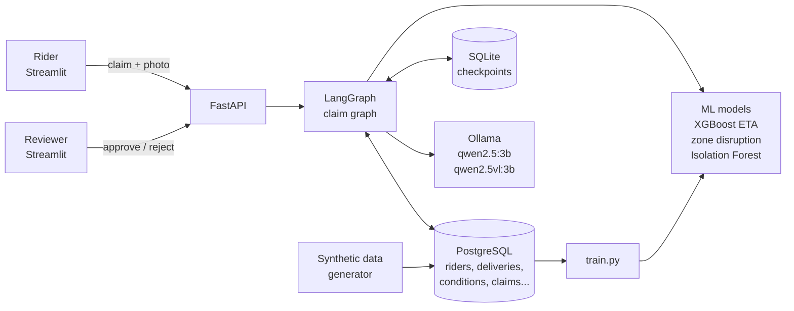
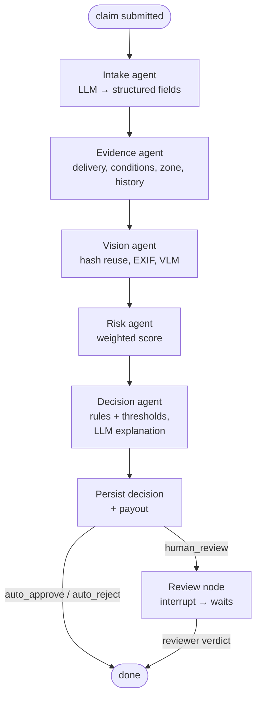
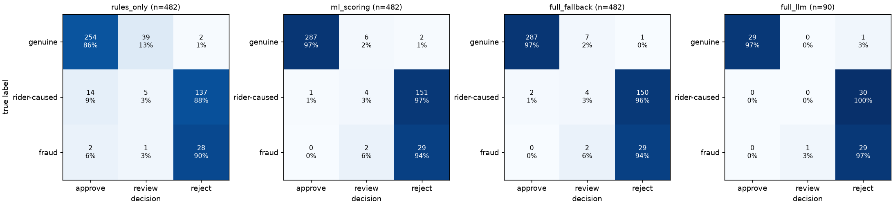

# RiderShield

**AI micro-insurance for gig delivery riders.** It tells genuine weather and traffic delays apart from rider-caused or fraudulent claims, decides clear cases automatically and sends only the uncertain ones to a human, with an explanation. Everything runs locally and for free.

  -black)

---

## Why I built this

Food and grocery delivery riders in India are paid per delivery and judged on ratings. When a monsoon storm floods an underpass, a jam locks up a junction or a road is barricaded, the delivery is late — and the rider often loses income or rating points for something completely outside their control. Most riders have almost no affordable insurance against this kind of everyday loss.

## The problem it solves

Insurers and platforms can't manually check thousands of tiny delay claims (each worth tens of rupees), and paying everyone blindly invites fraud. RiderShield separates **genuine external delays** from **rider-caused** delays and **fraudulent** claims, automatically approves or rejects the clear cases, and routes only the uncertain ones to a human reviewer with the evidence laid out — so small payouts stay fast, fair and cheap to run.

## How it works

The life of a claim:

1. **Submit.** The rider writes what happened in their own words ("underpass near BTM was flooded, order 43099 got 25 min late") and can attach a photo.
2. **Intake agent (LLM).** A local 3B model turns the text into structured fields: order number, reason (flooding, heavy rain, traffic jam, road closure, restaurant delay), claimed delay and time. Numbers written in the text are double-checked with a regex, and the delivery must belong to the rider.
3. **Evidence agent (SQL).** Pulls the delivery record, the zone's weather/traffic for that hour, how *other* riders in the same zone were doing at the same time, and the rider's history.
4. **Vision agent.** If there is a photo: perceptual-hash comparison against every earlier photo (catches re-used pictures), EXIF time and GPS against the delivery, and a small local vision model checks the photo actually shows the claimed situation.
5. **Risk agent (ML).** Combines six signals into a 0–1 risk score (details below).
6. **Decision agent.** Deterministic rules + calibrated thresholds → `auto_approve`, `auto_reject` or `human_review`. The LLM then writes a short explanation **only from a numbered list of facts** and must cite which facts it used.
7. **Human review.** `human_review` cases pause (LangGraph `interrupt`). The paused state lives in a SQLite checkpoint, so it survives a server restart. A reviewer approves or rejects in the dashboard and the claim resumes.
8. **Payout.** Plain policy code — never the LLM — pays `Rs 30 + Rs 2 per minute above 10 minutes`, capped at Rs 150. It pays for the smaller of the claimed delay and the observed delay plus 5 minutes; the 5 minutes cover the ETA model's typical error and go in the rider's favour.

## Architecture





**Components**

- **Data layer** (`db/`, `data/`): PostgreSQL with SQLAlchemy models and Alembic migrations. `data/generator.py` simulates 90 monsoon days in 12 Bengaluru zones: 500 riders, 50,000 deliveries, hourly rain/traffic/flood/closure conditions per zone, and 2,056 claims. Every claim has a ground-truth label (`genuine_external`, `rider_caused`, `fraudulent`) that comes from *how the delay was actually produced*, which makes honest evaluation possible. Labels are never used as features.
- **ETA regression** (`ml/eta.py`): XGBoost predicts delivery time from distance, zone, hour, weekday, vehicle, rain, traffic and flood/closure flags. It is used twice: under the real conditions and on a "normal day" for the same trip. The difference is the delay the conditions explain. Test MAE 5.1 min vs 8.8 for a distance-only baseline (see `ml/model_cards/eta.md`).
- **Zone disruption detector** (`ml/zone_disruption.py`): if most *other* deliveries in the same zone and time window were late — well above that zone's usual rate for that hour — something external was going on.
- **Rider anomaly detector** (`ml/anomaly.py`): an Isolation Forest over idle-time ratio, long-stop rate, speed, claims per week and claims per delivery. Its output is a percentile ("more unusual than 97% of riders").
- **Risk score** (`ml/risk.py`, weights in `ml/risk_config.toml`): a weighted average of six signals, each 0 (looks genuine) to 1 (looks risky):

  | signal | weight | meaning |
  |---|---|---|
  | condition_support | 0.30 | share of the real delay that conditions + restaurant wait do **not** explain |
  | claim_inflation | 0.20 | claimed minutes beyond what really happened |
  | zone_disruption | 0.15 | 1 − zone disruption score (neutral 0.5 if too few deliveries to judge) |
  | rider_anomaly | 0.15 | Isolation Forest percentile |
  | image_check | 0.10 | photo reused / EXIF mismatch / photo doesn't show the claim |
  | claim_history | 0.10 | claims in the previous 30 days |

  A missing signal (e.g. no photo) is skipped and the other weights are rescaled, so riders are never penalised for not attaching optional evidence. Thresholds were calibrated on **training-period** claims: at most 2% of auto-approvals may be non-genuine and at most 1% of auto-rejections genuine — wrongly rejecting a rider costs them real income, so that mistake gets the stricter limit.
- **Agents** (`agents/`): a LangGraph `StateGraph`. All LLM calls go through Ollama with a JSON schema and Pydantic validation, one retry on invalid JSON, and a deterministic fallback if the model still fails — a claim never gets stuck because the LLM had a bad moment.
- **API + UI** (`app/`, `ui/`): FastAPI accepts the claim, answers `202 Accepted` immediately and processes it in the background (CPU inference can take minutes). Streamlit has a Rider view and a Reviewer dashboard with the evidence panel, risk breakdown chart, photo and approve/reject buttons.

## Tech stack

| Component | Tool | Why |
|---|---|---|
| Database | PostgreSQL 16 (Docker, 512 MB limit) + SQLAlchemy 2 + Alembic | real relational data, versioned migrations |
| Synthetic data | NumPy + pandas, seeded | reproducible, labelled, realistic zone-wide events |
| ETA model | XGBoost | strong on tabular data, fast on CPU, native categorical support |
| Anomaly detection | scikit-learn Isolation Forest | unsupervised, works without fraud labels |
| Agent orchestration | LangGraph | explicit state graph, `interrupt` for human-in-the-loop, checkpointing |
| Checkpoints | SQLite (`langgraph-checkpoint-sqlite`) | paused reviews survive restarts, zero setup |
| LLM / VLM | Ollama with qwen2.5:3b and qwen2.5vl:3b | free, local, small enough for an 8 GB laptop |
| Validation | Pydantic | every LLM output is schema-checked |
| Photo checks | Pillow + ImageHash | perceptual hashing and EXIF parsing |
| API | FastAPI + Uvicorn | typed endpoints, background tasks, file uploads |
| UI | Streamlit | quick rider and reviewer dashboards in pure Python |
| Evaluation | pandas, scikit-learn, matplotlib | metrics tables and confusion matrices |

## Results

All numbers below come from [`evals/results/summary.md`](evals/results/summary.md), produced by `python -m evals.run`. **The data is synthetic** (see Limitations), so the absolute numbers are optimistic; the comparison between configurations is the meaningful part.

The held-out set is 482 labelled claims on deliveries after 10 Aug 2026 (295 genuine, 156 rider-caused, 31 fraudulent). No model was trained or tuned on them.

| configuration | claims | genuine precision | genuine recall | genuine F1 | fraud recall | automation rate | manual reviews | auto-decision error |
|---|---|---|---|---|---|---|---|---|
| rules-only baseline | 482 | 0.941 | 0.861 | 0.899 | 0.935 | 0.907 | 45 | 0.041 |
| ML scoring (no agents) | 482 | 0.997 | 0.973 | 0.985 | 1.000 | 0.975 | 12 | 0.006 |
| full pipeline, fallback intake | 482 | 0.993 | 0.973 | 0.983 | 1.000 | 0.973 | 13 | 0.006 |
| full pipeline, qwen2.5:3b intake | 90 | 1.000 | 0.967 | 0.983 | 1.000 | 0.989 | 1 | 0.011 |

- **rules-only** = a parametric trigger (approve if the zone had a recorded disruption or a long restaurant wait). It auto-approved 16 claims that were not genuine and needed 45 manual reviews.
- **ML scoring** and the **full pipeline** cut manual reviews by about 71–73% compared with the rules-only baseline (12–13 instead of 45), and only 0.6% of their automatic decisions were wrong.
- The **full pipeline** parses the claim from the rider's *text* instead of being handed structured fields, and still matches the ML-only numbers.
- **The LLM run** covers a stratified sample of 90 claims, because CPU inference on the 8 GB test laptop averaged about 14 s per claim. It matched the right delivery and the claimed delay in 100% of claims and the reason in 94% (its only mistake: calling flooding "heavy rain"). But in 91% of claims the model left a number that *is* written in the text out of its JSON, and the regex cross-check filled it in. A 3B model mostly gets the reason right but is unreliable at copying numbers, so the deterministic check is what makes intake dependable.



Model-level results are in the model cards: [ETA](ml/model_cards/eta.md) (test MAE 5.1 min vs 8.8 for a distance-only baseline), [zone disruption](ml/model_cards/zone_disruption.md), [rider anomaly](ml/model_cards/rider_anomaly.md) and [risk score](ml/model_cards/risk_score.md).

## How to run it on any laptop locally

### Prerequisites

- **Python 3.12** (the version this was built and tested with)
- **Docker Desktop** (Windows/Mac) or Docker Engine (Linux)
- **Ollama** — https://ollama.com/download
- **RAM:** 8 GB minimum. No GPU needed. About 8 GB of free disk for the two models and Docker.

### 1. Clone and install

```bash
git clone https://github.com/Aditya-7826/ridershield.git
cd ridershield
python -m venv .venv
```

Activate the virtual environment:

| OS | command |
|---|---|
| Windows (PowerShell) | `.venv\Scripts\Activate.ps1` |
| Windows (cmd) | `.venv\Scripts\activate.bat` |
| Mac / Linux | `source .venv/bin/activate` |

```bash
pip install -r requirements.txt
```

### 2. Configure

```bash
# Mac / Linux
cp .env.example .env
# Windows (PowerShell)
Copy-Item .env.example .env
```

The defaults work as they are. On a laptop with a small GPU, set `OLLAMA_NUM_GPU=0` (see low-RAM tips).

### 3. Models and database

```bash
ollama pull qwen2.5:3b
ollama pull qwen2.5vl:3b
docker compose up -d
python scripts/health_check.py      # should print PASS four times
```

### 4. Create tables, generate data, train models

```bash
alembic upgrade head
python scripts/seed_db.py           # ~20 s: riders, deliveries, conditions, labelled claims
python scripts/train.py --model all # ~1 min: ETA model, zone detector, anomaly model + model cards
python scripts/risk_report.py       # optional: how the risk score separates the labels
```

### 5. Start the app

One command starts both the API and the UI and opens the browser:

```bash
python scripts/start.py            # add --no-llm to run without Ollama
```

The app is the Streamlit UI at **http://localhost:8501**. The API on port 8000 has no page of its own: http://localhost:8000 redirects to its docs. Press Ctrl+C to stop both.

The launcher binds both servers to `localhost`, so the app is only reachable from your own machine. There is no login, so don't expose it on a network. Other options: `--no-browser`, `--api-port`, `--ui-port`.

Prefer separate processes? Run each in **its own terminal** (venv active in both). `uvicorn` keeps its terminal busy, so a second command pasted into the same terminal never runs:

```bash
uvicorn app.main:create_app --factory --port 8000     # terminal 1
streamlit run ui/app.py                               # terminal 2
```

### 6. Tests and evaluation

```bash
python -m pytest -q                 # unit + integration tests (DB tests are skipped without the seeded database)
python -m evals.run --no-llm        # ~3 min: re-runs everything except the LLM sample (reuses its saved results)
python -m evals.run --fresh         # also re-runs the LLM sample from scratch; slow on CPU (see Results)
```

On Mac/Linux, `make setup`, `make start`, `make api`, `make ui`, `make test` and `make eval` wrap the same commands.

### Command-line alternatives

```bash
# submit a claim (with a photo) without the UI
python scripts/submit_claim.py --rider 93 --delivery-id 42181 --photo tests/fixtures/flooded_road.jpg \
    --text "Underpass near BTM was flooded, order 42181 reached 20 min late"
# re-run a held-out labelled claim
python scripts/submit_claim.py --sample fraudulent
# list and resolve claims waiting for review (works after a restart)
python scripts/review_claim.py --list
python scripts/review_claim.py --claim-id <id> --verdict approve --reviewer <your-name>
```

### Low-RAM tips

- Only one model is loaded at a time: the vision agent unloads the text model first and unloads itself afterwards, and `OLLAMA_KEEP_ALIVE=2m` frees idle models.
- If Ollama fails with `cudaMalloc failed: out of memory`, your GPU is too small — set `OLLAMA_NUM_GPU=0` in `.env` to run on CPU.
- Close browsers, chat apps and heavy IDE extensions before using the LLM. On an 8 GB machine, a claim with a photo took about 5 minutes on CPU while swapping; text-only claims about 40–70 seconds.
- Stop containers from other projects while using RiderShield (`docker ps` to list them, `docker stop <name>`); RiderShield itself only needs `ridershield-postgres`, capped at 512 MB.
- Docker Desktop's WSL VM keeps file cache it doesn't need. On Windows, `wsl -d docker-desktop sh -c "sync; echo 3 > /proc/sys/vm/drop_caches"` hands it back.
- Run the evaluation with `--no-llm` for quick numbers; the LLM sample saves after every claim and resumes if interrupted.

### Troubleshooting

| problem | fix |
|---|---|
| `health_check.py`: Ollama not reachable | start the Ollama app (or `ollama serve`) |
| `model missing` | run the `ollama pull ...` command the health check prints |
| Ollama `500` / out of memory | the model doesn't fit: close apps, set `OLLAMA_NUM_GPU=0`, or try a smaller model (e.g. `VISION_MODEL=moondream`) |
| PostgreSQL connection timeout | `docker compose up -d`; check Docker Desktop is running |
| port 5433 already in use | change `POSTGRES_PORT` in `.env`, then `docker compose up -d` again |
| `ETA model not found` | run `python scripts/train.py --model all` |
| claims stay "pending" in the UI | the LLM is still working on CPU — wait and press Refresh; check the API terminal for errors |
| http://localhost:8000 shows `{"detail":"Not Found"}` or nothing loads | the app is the UI on port **8501**; make sure Streamlit is running (`python scripts/start.py` starts both) |

## Example claims to try

Pick a delivery from the Rider view's list (they are from the synthetic Aug 2026 data), then try:

- **Genuine flood:** pick a delivery in a flood hour and write "The underpass near the main road was flooded, water up to the knees. My order was about 25 minutes late." You can attach `tests/fixtures/flooded_road.jpg`; its EXIF date is fixed (20 Aug 2026, 19:30), so on most deliveries the EXIF check will flag it as not taken during the delivery — that is the check doing its job.
- **Traffic jam:** "Massive traffic jam near the junction, nothing was moving, order 30 min late."
- **Restaurant delay:** "Food was not ready at pickup, I waited a long time. 20 minute delay."
- **Re-used photo:** submit a second claim from another rider with `tests/fixtures/flooded_road_copy.jpg` — it is a resized copy of the first photo, gets flagged as re-used and lands in the Reviewer queue.
- **Wrong photo:** claim a flood but attach `tests/fixtures/clear_road.jpg` and watch what the vision model says.
- **Inflated claim:** pick a delivery on a clear day and claim "heavy rain, 45 minutes late".

## Project structure

```
ridershield/
├── app/            FastAPI app (claims, review, stats, health) + background processor
├── agents/         LangGraph graph and the intake, evidence, vision, risk, decision, review agents
├── ml/             ETA model, zone disruption, anomaly model, photo checks, risk score, model cards
├── db/             SQLAlchemy models, Alembic migrations, session, per-claim queries
├── data/           seeded synthetic data generator
├── policy/         deterministic payout rules
├── ui/             Streamlit rider + reviewer views and API client
├── evals/          evaluation runner, metrics, results (summary.md, confusion matrix)
├── scripts/        one-command launcher, health check, seeding, training, risk report, CLI submit/review, fixtures
├── tests/          pytest suite and small generated test photos
├── docker-compose.yml, alembic.ini, requirements.txt, Makefile, .env.example, LICENSE
```

## Limitations and future work

- **Synthetic data.** The generator makes signals cleaner than real life, so the absolute numbers are optimistic. Real deployments would need real delivery telemetry, real weather feeds and real claims, and the thresholds would need recalibrating (most likely with a wider human-review band).
- **Small models.** 3B models run on a laptop but miss things — during development the text model left an explicitly written order number and delay empty, which is why written numbers are cross-checked with a regex. The vision model was only tested on simple generated pictures.
- **Fairness for riders.** "Unusual behaviour" is not the same as dishonesty: new riders, riders in slow zones or on slower vehicles can look different for innocent reasons. That is why the anomaly signal has a modest weight, why wrongly rejecting a genuine claim is held to the strictest error limit, and why borderline cases go to a person. A real system should audit decisions per zone, vehicle type and rider tenure, and give riders a way to appeal.
- **No authentication** and no deployment — this is a local prototype.
- **Future work:** real historical weather (e.g. Open-Meteo) for the conditions table, per-group fairness reports in the evaluation, reviewer feedback used to recalibrate thresholds, and multilingual claims (Hindi, Kannada, Hinglish).

## License

MIT — see [LICENSE](LICENSE).
