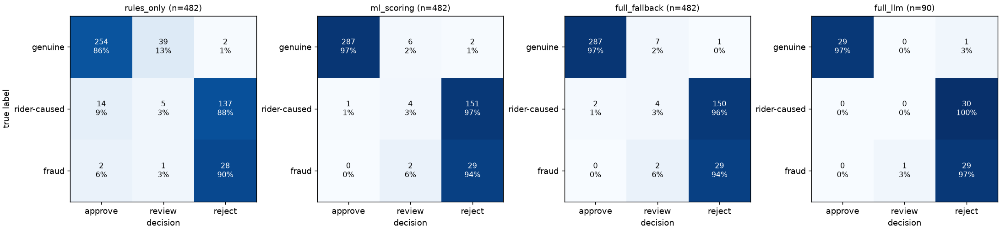

# RiderShield evaluation

_Generated by `python -m evals.run` on 2026-11-11 23:40. Do not edit by hand._

**Data:** synthetic claims from `data/generator.py` (seed 42). Held-out set = 482 claims on deliveries after 2026-08-10 (genuine_external: 295, rider_caused: 156, fraudulent: 31). No model was trained or tuned on them.

## Results

| configuration | claims | genuine precision | genuine recall | genuine F1 | fraud recall | automation rate | manual reviews | auto-decision error |
|---|---|---|---|---|---|---|---|---|
| rules_only | 482 | 0.941 | 0.861 | 0.899 | 0.935 | 0.907 | 45 | 0.041 |
| ml_scoring | 482 | 0.997 | 0.973 | 0.985 | 1.000 | 0.975 | 12 | 0.006 |
| full_fallback | 482 | 0.993 | 0.973 | 0.983 | 1.000 | 0.973 | 13 | 0.006 |
| full_llm | 90 | 1.000 | 0.967 | 0.983 | 1.000 | 0.989 | 1 | 0.011 |

- **genuine P/R/F1:** a claim counts as identified when it is auto-approved; genuine claims sent to review count as misses for recall (they still reach a human).
- **fraud recall:** share of fraudulent claims that were *not* auto-approved.
- **auto-decision error:** wrong automatic decisions / automatic decisions (auto-approving a non-genuine claim or auto-rejecting a genuine one).

## Manual review workload

- **rules_only:** 45 of 482 claims need a human (9.3%); 90.7% fewer reviews than checking every claim manually.
- **ml_scoring:** 12 of 482 claims need a human (2.5%); 97.5% fewer reviews than checking every claim manually; 73% fewer than the rules-only baseline.
- **full_fallback:** 13 of 482 claims need a human (2.7%); 97.3% fewer reviews than checking every claim manually; 71% fewer than the rules-only baseline.
- **full_llm:** 1 of 90 claims need a human (1.1%); 98.9% fewer reviews than checking every claim manually.

## Wrong automatic decisions

- **rules_only:** auto-approved but not genuine: 16 claims; auto-rejected but genuine: 2 claims.
- **ml_scoring:** auto-approved but not genuine: 1 claim; auto-rejected but genuine: 2 claims.
- **full_fallback:** auto-approved but not genuine: 2 claims; auto-rejected but genuine: 1 claim.
- **full_llm:** auto-approved but not genuine: 0 claims; auto-rejected but genuine: 1 claim.

## Confusion matrices

| rules_only: true \ decision | auto_approve | human_review | auto_reject |
|---|---|---|---|
| genuine_external | 254 | 39 | 2 |
| rider_caused | 14 | 5 | 137 |
| fraudulent | 2 | 1 | 28 |

| ml_scoring: true \ decision | auto_approve | human_review | auto_reject |
|---|---|---|---|
| genuine_external | 287 | 6 | 2 |
| rider_caused | 1 | 4 | 151 |
| fraudulent | 0 | 2 | 29 |

| full_fallback: true \ decision | auto_approve | human_review | auto_reject |
|---|---|---|---|
| genuine_external | 287 | 7 | 1 |
| rider_caused | 2 | 4 | 150 |
| fraudulent | 0 | 2 | 29 |

| full_llm: true \ decision | auto_approve | human_review | auto_reject |
|---|---|---|---|
| genuine_external | 29 | 0 | 1 |
| rider_caused | 0 | 0 | 30 |
| fraudulent | 0 | 1 | 29 |

## LLM intake (qwen2.5:3b, CPU)

The `full_llm` row runs the same pipeline with the local LLM parsing the claim text, on a stratified sample of 90 held-out claims (up to 30 per label, sampled with seed 42) because CPU inference is slow on the 8 GB test laptop: about 14s per claim on average, with the first claims taking over a minute while the model loaded under memory pressure. LLM explanations were switched off for this run; they do not affect the decision.

- delivery matched correctly: 100.0%
- reason category matches the claim's category: 94.4% (errors: flooding -> heavy_rain (5))
- claimed delay extracted within 1 minute: 100.0%
- LLM output missing a number that is written in the text, filled by the regex cross-check: 91.1% of claims (order number missing or not found in the text: 84.4%; delay: 38.9%)
- LLM failures (fell back to regex completely): 0

So the 3B model mostly gets the reason right (94%) but is unreliable at copying numbers into the right JSON field; the deterministic cross-check is what makes the intake dependable. On these template-based texts the regex alone does better still; the LLM's value is on free-form text the templates don't cover.

For comparison, the deterministic fallback intake on the same sample: delivery 100.0%, reason 100.0%, delay 100.0%.

## Caveats

- The data is synthetic and the generator makes the signals cleaner than real life, so absolute numbers are optimistic. The comparison between configurations is the meaningful part.
- Seeded photos exist only as metadata (hash, EXIF), so the vision model's content check is not part of these numbers; photo reuse and EXIF checks are.
- `ml_scoring` uses a rider-behaviour snapshot at the train cutoff; the agent pipeline computes it per claim from history up to the claim time. Both use only past data.
- Risk weights were set by hand; thresholds were calibrated on training-period claims only.
- The synthetic claim texts come from a small set of templates, so the regex fallback intake parses them almost perfectly. Real riders write far messier text; that is the job of the LLM intake, and the `full_llm` row shows how the local model does on the same claims.
